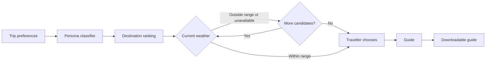

# Multi-Agent Travel Discovery Planner

Discover a destination from the kind of trip you want, then build a two-day guide.

**[Try the hosted planner](https://travel-planner.gentlemushroom-48179c71.centralus.azurecontainerapps.io/)**

Example: *I love local food, historic neighborhoods and architecture. I'd like a relaxed two-day city break with time to explore on foot.*

## How it works

1. **Persona:** local DeBERTa zero-shot classification identifies three travel preferences. Explicit beach/ocean language is preserved as a coastal requirement.
2. **Discovery:** local MiniLM embeddings compare the full prompt plus persona labels against city names, countries and feature descriptions in the single 500-city catalogue, `data/top_500_cities.json`, with one city per country in the shortlist. Coastal descriptions are merged into the original features of 19 cities, alongside a `coastal: true` flag. Ocean/beach requests filter that same catalogue by the flag; alternative searches preserve that requirement. Coastal coverage is curated and is not an exhaustive coastline database.
3. **Weather:** LangGraph checks current apparent temperature and advances through the shortlist until a city passes the 15–28 °C comfort range.
4. **Writing:** itinerary, cultural guide and packing instructions produce the travel guide. All three agents call the unchanged `generate(prompt, max_tokens, temperature)` interface in `utils/mistral.py`. That single file tries Gemini first and Hugging Face second. The three agents run independently in parallel, using up to three primary requests per full guide, plus retries/fallbacks.
5. **Your decision:** every UI discovery pauses before writing. Review all shortlisted cities and their weather, then approve your choice. If no city passes, override the weather preference or search for alternatives. Discovery and alternative searches do not consume generation quota; approved guides and writing retries do.



The app uses Streamlit and LangGraph. It does not expose a FastAPI service.

## Reliability and public-demo controls

- Progress messages belong to the current request; visitors do not share an activity queue. A persistent activity trace shows persona labels, shortlist, weather, approval, individual writing-agent activity and provider/fallback outcomes. An always-visible workflow diagram shows the approval gate.
- Failed writing preserves preferences, destination matches and weather observations.
- Missing writing sections can be retried without replacing successful sections.
- Weather failures are shown as unavailable, never accepted as comfortable weather.
- Model credentials and provider response bodies are not displayed to visitors.
- The container runs as a non-root user. Streamlit's XSRF protection stays enabled.
- A process-wide gate allows one expensive operation at a time.
- Default caps: one guide-generation operation per minute, five per browser session per hour, five globally per hour and five globally per rolling day. Writing retries also count; discovery and alternative searches share the concurrency gate without consuming model-generation quota.
- Gemini HTTP 429 responses immediately fall through to Hugging Face and cool only the failed candidate.
- Both providers use the same ordered-candidate policy, bounded retries and per-candidate cooldowns. The retry budget reserves time for the fallback. Provider-specific request encoding lives in the same client file.
- A missing, rejected or exhausted credential does not disable candidates using the other provider. The Hugging Face token still needs available credits for the fallback to succeed.

**Limits are process-local and reset on restart.** Keep one replica. These controls are demo safeguards, not authentication, a durable quota system or a billing guarantee. A shared limiter and persistence are required before broader public traffic or multiple replicas.

## Local setup

Use Python 3.12:

```bash
python3 -m venv .venv
source .venv/bin/activate
pip install -r requirements.txt
cp .env.example .env
```

Set `GEMINI_API_KEY` and `HUGGINGFACEHUB_API_TOKEN` in `.env`. The default candidate order is Gemini followed by Hugging Face. Then:

```bash
cd travel_planner
streamlit run app.py
```

The first local run downloads the DeBERTa and MiniLM models. Production images bake them in at build time. The landing page renders before the local models are imported.

### Model configuration

| Variable | Purpose |
|---|---|
| `GEMINI_API_KEY` | Gemini credential; never commit it |
| `GEN_TIMEOUT` | Socket inactivity timeout per request in seconds |
| `HUGGINGFACEHUB_API_TOKEN` | Credential for the Hugging Face fallback; requires available credits |
| `GEN_CANDIDATES` | Ordered `provider\|model` pairs; default `gemini\|gemini-2.5-flash,auto\|meta-llama/Llama-3.1-8B-Instruct` |
| `GEN_TOTAL_TIMEOUT` | Shared retry scheduling budget; active network requests may overrun it |
| `SESSION_PLANS_PER_HOUR` | Per-browser-session hourly cap |
| `GLOBAL_PLANS_PER_MINUTE` | Per-process per-minute cap |
| `GLOBAL_PLANS_PER_HOUR` | Per-process rolling hourly cap |
| `GLOBAL_PLANS_PER_DAY` | Per-process rolling 24-hour cap |

The configured Gemini model was verified by a real API call with this project’s credential. AI Studio quota values require an authenticated Google session; they have not been independently read here. Gemini quotas vary by model, project and account. Check the project's actual limits in [AI Studio](https://ai.google.dev/gemini-api/docs/rate-limits). A free-tier key is not unlimited. Google may use free-tier inputs and outputs to improve its products; do not submit sensitive information. See [Gemini pricing and data use](https://ai.google.dev/gemini-api/docs/pricing).

## Validation

```bash
pip install pytest==9.1.1
python -m pytest -q
```

Tests exercise real LangGraph routing with deterministic model boundaries, provider fallback and authentication errors, both response formats and quota cooldowns, partial generation, weather failure handling, request-local logging and usage admission. UI tests use Streamlit's AppTest. Live smoke checks are separate and require working model credentials.

### Live fallback smoke test

With credentials loaded from environment variables or a gitignored `.env`:

```bash
GEN_CANDIDATES='bogus|fake/model,gemini|gemini-2.5-flash' \
  python -c 'import sys; sys.path.insert(0, "travel_planner"); from utils.mistral import generate; assert generate("Say hello in one sentence.", max_tokens=32); print("Fallback passed")'
```

Then run a full plan with the default candidates. An exhausted Hugging Face account cannot serve fallback traffic even when the routing logic is correct.

## Azure deployment

The existing app uses Azure Container Apps in `travel-planner-rg` and ACR `tpacr10229`, with 1 vCPU and 2 GiB memory. Credentials are injected from Container Apps secrets.

A clean build uses `Dockerfile`:

```bash
az acr build --registry tpacr10229 --image travel-planner:<unique-tag> --file Dockerfile --platform linux/amd64 .
```

`Dockerfile.release` offers a faster source-only release on top of the exact deployed v1 runtime digest, reusing its dependencies and baked-in model weights. It requires access to this project's private registry. Use the normal Dockerfile for an independent clean build or dependency updates.

After setting the `gemini-api-key` Container Apps secret through a secure channel:

```bash
az containerapp update -n travel-planner -g travel-planner-rg \
  --image tpacr10229.azurecr.io/travel-planner:<unique-tag> \
  --min-replicas 1 --max-replicas 1 \
  --set-env-vars GEMINI_API_KEY=secretref:gemini-api-key \
    'GEN_CANDIDATES=gemini|gemini-2.5-flash,auto|meta-llama/Llama-3.1-8B-Instruct' \
    GEN_TIMEOUT=20 GEN_TOTAL_TIMEOUT=75 \
    GLOBAL_PLANS_PER_MINUTE=1 GLOBAL_PLANS_PER_HOUR=5 GLOBAL_PLANS_PER_DAY=5
```

One warm replica reduces cold starts but consumes Azure resources while idle. Set `--min-replicas 0` when the review window ends if scale-to-zero is preferred. That reintroduces cold starts.

Before sharing, verify the revision is ready, `/_stcore/health` returns 200, and a complete query works without login. Keep the previous image and revision available for rollback; changing the image alone does not roll back configuration.

## Practical limits

- Weather is current apparent temperature, cached for up to an hour, not a future trip forecast or a safety assessment.
- The city catalogue uses broad feature descriptions; destination scores are approximate and ties are common. Enriching city-specific data is the most valuable ranking improvement.
- Travel dates, flight prices, bookings, opening hours and live availability are not verified.
- AI output can be inaccurate; verify local requirements and details before traveling.
- Results are browser-session state and disappear on restart. There is no shared persistence or authentication.
- Full dependency vulnerability review, load testing, durable quotas, monitoring and content evaluation remain necessary for a general production service.
