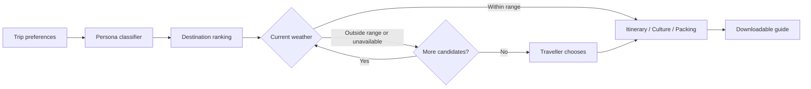

# Multi-Agent Travel Discovery Planner

Discover a destination from the kind of trip you want, then build a two-day guide.

**[Try the hosted planner](https://travel-planner.gentlemushroom-48179c71.centralus.azurecontainerapps.io/)**

Example: *I love local food, historic neighborhoods and architecture. I'd like a relaxed two-day city break with time to explore on foot.*

## How it works

1. **Persona:** local DeBERTa zero-shot classification identifies three travel preferences.
2. **Discovery:** local MiniLM embeddings rank a 500-city catalogue, with one city per country in the shortlist.
3. **Weather:** LangGraph checks current apparent temperature and advances through the shortlist until a city passes the 15–28 °C comfort range.
4. **Writing:** itinerary, cultural guide and packing instructions produce the travel guide. Gemini combines these three writing tasks into one structured request to conserve free-tier quota. The optional Hugging Face backend runs three independent requests in parallel.
5. **Your decision:** if no city passes, choose a shortlisted city anyway or search the full catalogue for weather-checked alternatives.



The app uses Streamlit and LangGraph. It does not expose a FastAPI service.

## Reliability and public-demo controls

- Progress messages belong to the current request; visitors do not share an activity queue.
- Failed writing preserves preferences, destination matches and weather observations.
- Missing writing sections can be retried without replacing successful sections.
- Weather failures are shown as unavailable, never accepted as comfortable weather.
- Model credentials and provider response bodies are not displayed to visitors.
- The container runs as a non-root user. Streamlit's XSRF protection stays enabled.
- A process-wide gate allows one expensive operation at a time.
- Default caps: one operation per minute, five per browser session per hour, ten globally per hour and ten globally per rolling day. Alternative searches and retries also count.
- Gemini HTTP 429 responses trigger a cooldown rather than immediate repeated requests.
- Hugging Face supports ordered candidates, bounded retries and per-candidate cooldowns.

**Limits are process-local and reset on restart.** Keep one replica. These controls are demo safeguards, not authentication, a durable quota system or a billing guarantee. A shared limiter and persistence are required before broader public traffic or multiple replicas.

## Local setup

Use Python 3.12:

```bash
python3 -m venv .venv
source .venv/bin/activate
pip install -r requirements.txt
cp .env.example .env
```

Set `GEN_BACKEND=gemini` and `GEMINI_API_KEY` in `.env`. Then:

```bash
cd travel_planner
streamlit run app.py
```

The first local run downloads the DeBERTa and MiniLM models. Production images bake them in at build time. The landing page renders before the local models are imported.

### Model configuration

| Variable | Purpose |
|---|---|
| `GEN_BACKEND` | `gemini` or `huggingface` |
| `GEMINI_API_KEY` | Gemini credential; never commit it |
| `GEMINI_MODEL` | Defaults to `gemini-2.5-flash` |
| `GEN_TIMEOUT` | Socket inactivity timeout per request in seconds |
| `HUGGINGFACEHUB_API_TOKEN` | Credential for the optional Hugging Face backend |
| `GEN_CANDIDATES` | Ordered `provider\|organization/model` pairs; use `auto` for router selection |
| `GEN_TOTAL_TIMEOUT` | Hugging Face retry scheduling budget; active network requests may overrun it |
| `SESSION_PLANS_PER_HOUR` | Per-browser-session hourly cap |
| `GLOBAL_PLANS_PER_MINUTE` | Per-process per-minute cap |
| `GLOBAL_PLANS_PER_HOUR` | Per-process rolling hourly cap |
| `GLOBAL_PLANS_PER_DAY` | Per-process rolling 24-hour cap |

Gemini quotas vary by model, project and account. Check the project's actual limits in [AI Studio](https://ai.google.dev/gemini-api/docs/rate-limits). A free-tier key is not unlimited. Google may use free-tier inputs and outputs to improve its products; do not submit sensitive information. See [Gemini pricing and data use](https://ai.google.dev/gemini-api/docs/pricing).

## Validation

```bash
pip install pytest==9.1.1
python -m pytest -q
```

Tests exercise real LangGraph routing with deterministic model boundaries, provider fallback and authentication errors, Gemini JSON parsing and quota cooldowns, partial generation, weather failure handling, request-local logging and usage admission. UI tests use Streamlit's AppTest. Live smoke checks are separate and require working model credentials.

## Azure deployment

The existing app uses Azure Container Apps in `travel-planner-rg` and ACR `tpacr10229`, with 1 vCPU and 2 GiB memory. Credentials are injected from Container Apps secrets.

A clean build uses `Dockerfile`:

```bash
az acr build --registry tpacr10229 --image travel-planner:<unique-tag> --file Dockerfile --platform linux/amd64 .
```

`Dockerfile.release` offers a faster source-only release on top of the exact deployed v1 runtime digest, reusing its dependencies and baked-in model weights. It requires access to this project's private registry. Use the normal Dockerfile for an independent clean build or dependency updates.

After setting the `gemini-api-key` Container Apps secret through a secure channel:

```bash
az containerapp update -n travel-planner -g travel-planner-rg \
  --image tpacr10229.azurecr.io/travel-planner:<unique-tag> \
  --min-replicas 1 --max-replicas 1 \
  --set-env-vars GEN_BACKEND=gemini GEMINI_API_KEY=secretref:gemini-api-key \
    GEMINI_MODEL=gemini-2.5-flash GEN_TIMEOUT=35 \
    GLOBAL_PLANS_PER_MINUTE=1 GLOBAL_PLANS_PER_HOUR=10 GLOBAL_PLANS_PER_DAY=10
```

One warm replica reduces cold starts but consumes Azure resources while idle. Set `--min-replicas 0` when the review window ends if scale-to-zero is preferred. That reintroduces cold starts.

Before sharing, verify the revision is ready, `/_stcore/health` returns 200, and a complete query works without login. Keep the previous image and revision available for rollback; changing the image alone does not roll back configuration.

## Practical limits

- Weather is current apparent temperature, cached for up to an hour, not a future trip forecast or a safety assessment.
- The city catalogue uses broad feature descriptions; destination scores are approximate and ties are common. Enriching city-specific data is the most valuable ranking improvement.
- Travel dates, flight prices, bookings, opening hours and live availability are not verified.
- AI output can be inaccurate; verify local requirements and details before traveling.
- Results are browser-session state and disappear on restart. There is no shared persistence or authentication.
- Full dependency vulnerability review, load testing, durable quotas, monitoring and content evaluation remain necessary for a general production service.
